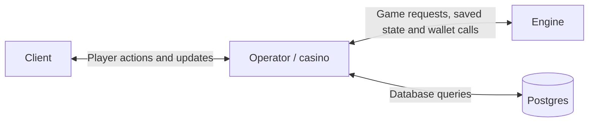

# HighStack — Game Mechanic Assessment

A deterministic, configurable bonus added to the supplied crash game. It includes the missing wallet receiver and player client, persistent round replay, and tests for the mechanic and money handling. The original brief shipped with the starter is preserved in [docs/STARTER_README.md](docs/STARTER_README.md).

## Run and demonstrate

```sh
docker compose up --build
```

Open **http://localhost:3100**. The demo player starts with **$1,000.00**. Place a bet during the five-second betting window, then cash out manually or set an automatic target. The final result shows base winnings, bonus, cap and payment status. After the round ends, select **Replay** to verify the saved outcome.

The example cards demonstrate no bonus, configured multipliers and the win cap using the same calculation as live play. They never alter the wallet. A bonus occurs with the configured probability in live rounds, so examples make every branch easy to inspect.

Postgres data survives normal restarts. Seeding never resets an existing balance. Only the demo website is published to localhost. Postgres and the engine have no published ports. To change the website port, set `DEMO_PORT` in `.env` using `.env.example`.

## Verify

There are three added assessment tests: deterministic bonus/cap/config validation, zero chance and weighted multipliers, and a basic wallet payout/replay check that also rejects overspending and duplicate credit. The starter's six original tests are retained.

Run these with an isolated test database:

```sh
docker compose --profile test run --build --rm tests
```

With the demo running, Node 22+ can exercise a live bet, duplicate request, wallet balance and replay:

```sh
npm run test:smoke
```

Use an idle demo so other bets do not change the balance during this check. Set `MANUAL_CASHOUT=1` to also check that a successful cash-out returns payment status `paid`. Set `DEMO_URL` if you changed the port.

For host unit tests: `npm ci && npm test`. Host database tests require a dedicated `TEST_DATABASE_URL` and `npm run test:integration`; never point this at a production database.

## What was there and what we added

### Already in the starter

The `engine` ran the crash game: betting, multiplier growth, cash-outs, seed verification and live events. It could send signed debit/credit requests to a wallet service. Docker also started Postgres, but the starter had no receiving wallet service, player website or saved round history.

### Added for this assessment

| Location | What it does |
| --- | --- |
| `packages/bonus` | Calculates the bonus trigger, weighted multiplier and capped winnings. Validates its config. Another game can reuse it. |
| `configs/bonus.json` | Holds the editable bonus chance, multiplier table, win cap and version. |
| `packages/storage` | The operator's database code for configs, rounds, bets, balances and payment receipts. Includes tables and migrations. |
| `engine/src` changes | Calculate bonus outcomes, ask the operator to save records, and immediately request the wallet credit at cash-out. Recover unfinished payments once at startup. |
| `operator/src` | The server between the website, engine and database. Owns all database access, saves engine results, handles money and forwards live updates. |
| `client/src` | Small React website for betting, cash-out, bonus results, examples and replay. |
| Tests and Docker setup | Check the mechanic and money handling, and start the complete demo together. |

A **package** is a named group of reusable code. Both applications import the bonus calculation. Only the operator imports storage.

The original engine stays in JavaScript; new operator code uses TypeScript. The bonus calculation is separate from database and HTTP code.

The browser uses only the operator API. It cannot choose a player, submit a payout or obtain the operator key. This is deliberately one seeded demo identity; it is not production authentication.

The browser creates a `betId` before submitting a bet and keeps that same ID for retries. The operator forwards it to the engine. After checking the round, the engine asks the operator to save it as `bets.id`; responses call it `betId`. Wallet operations use `debit:<betId>` and `credit:<betId>` so a repeated payment can be recognised. The starter's separate `sessionId` still identifies the player to the engine when creating the bet.

## Communication and database ownership

The communication is **client ↔ operator ↔ engine**. Only the operator connects to the database. The engine decides game actions and calculates outcomes; it asks the operator to save them and handle money.



This keeps the casino's database behind its own API. A replacement engine or a future StackStudio game variant uses that API without database credentials or knowledge of the tables. The casino can also replace the operator's database implementation while keeping that API; this demo uses Postgres. A third-party provider needs a compatible integration or an adapter in the operator; arbitrary providers are not automatically interchangeable.

For a $10 bet B1, the engine first asks the operator to save B1 as pending. It then asks for the $10 debit. At cash-out, it calculates the base winnings and bonus together and sends one final outcome. The operator authenticates the request, validates the fields and checks that B1 can be settled. It saves the engine's result and pending payment in one transaction, without recalculating the game rules. The engine immediately requests the credit through the existing wallet path and returns the confirmed payment status. There is no periodic payment worker or pending-payment lookup in a successful cash-out. This keeps the game calculation in the engine and money handling in the operator. Read-only replay can recalculate a saved result without paying it again.

Engine-to-operator `/engine/*` requests are signed over their timestamp, HTTP method, path, engine ID and exact body. The API accepts specific actions: start/heartbeat/stop, save a round or bet, update its state, record a win/loss and list pending payments. It exposes no SQL or general table access. The operator keeps the database clock lock for the active engine. Every three seconds the engine sends a heartbeat, a small "still running" request, which renews its 15-second permission. Another engine cannot take over while it is active. Repeated requests reuse their original IDs and results.

The engine has its own runtime image, with game code and the bonus package. It has no database URL, storage package or Postgres driver. Its Docker network reaches the operator but is separate from the database network. The operator alone reads the config file and runs migrations. This boundary assumes game variants change engine code while the casino controls the operator and deployment configuration. Engine integrations remain authorised callers; database isolation does not independently prove that game timing is correct.

## Rules and deterministic calculation

`evaluateBonus(seed, bet, config)` takes:

- Seed: `{ serverSeed, nonce }`.
- Bet: `{ amount, baseWin }`, in integer minor units.
- Config: `{ version, triggerChance, multipliers, maxWin }`.

It returns `triggered`, `multiplier`, `baseWin`, `finalWin`, `capped` and `configVersion`. The same complete inputs reproduce the same outcome. All bets in one round share the same bonus decision. A losing bet has zero base winnings and stays zero.

The trigger uses millionths of probability. Multipliers support two decimals; weights are non-negative integers with a positive, safe-integer total. Independent HMAC-SHA256 draws use the server seed as a UTF-8 key and JSON text `["bonus-v1", nonce, version, label, counter]` as the message. Labels are `trigger` and `multiplier`. Rejection sampling maps the 256-bit value into each integer range without modulo bias.

Base cash-out winnings are floored first, following the starter. Bonus multiplication uses `BigInt` hundredths, floors once, then caps the **total payout**, including when the bonus does not trigger. The cap includes the stake already present in the base payout; it is not an additional-profit cap. Balances and API money remain safe integers, not floating-point currency.

Every round saves its seed, nonce and immutable config version before betting opens. Settlement saves the bet, base winnings, selected multiplier and final result. Replay loads those inputs and checks the same function against the saved outcome. Seeds stay private until the round ends, preserving the starter's hash commitment. Replay cannot issue payments.

The promised official bonus seed examples were not supplied. The project-owned regression vector uses seed `assessment-example`, nonce `0`, version `test-v1`, chance `1`, weights `60/30/10` for `2x/5x/10x`, stake `100`, base win `200` and cap `100000`: the selected bonus is `5x`, final win `1000`. This is documented implementation behaviour, not a claim to match unavailable official vectors.

## Change config

Edit [configs/bonus.json](configs/bonus.json). For example, change `triggerChance` to `0.1`, alter table weights or set `maxWin` to `50000`. **Give changed content a new version**, such as `bonus-v2`.

The operator reads and validates the config when the engine requests a new round. It saves the version and returns those settings and the generated nonce to the engine. The bonus module freezes the settings it uses. An existing round and its replay retain the original snapshot. The operator's example cards are cached at startup; restarting it refreshes them, and the engine reconnects and recovers interrupted work.

Values such as chance `1.2`, a negative weight, an empty/all-zero table or fractional `maxWin` are rejected. Reusing a version for different content is rejected. Invalid config stops new play with a visible connection error and server log; it is never silently replaced. Fix the file and restart the affected service.

## Add another mechanic

Another game can import the existing module directly:

```ts
const outcome = evaluateBonus(
  { serverSeed, nonce },
  { amount: stakeInCents, baseWin: baseWinInCents },
  validatedConfig,
);
// Persist outcome; send outcome.finalWin through that game's wallet path.
```

For a different rule, add a pure function with the same explicit input/output boundary and its own validated config. Update engine settlement (`calculateOutcome`) and round reveal (`game.js`), plus the read-only replay and example calculations. Record the new config/rule version and test deterministic results and the new rule's edges. If the outcome fields stay the same, the operator's settlement and wallet code need no game-rule changes. Database queries stay in the operator; wallet signatures and payment confirmation remain separate from game mathematics.

## Money and failure modes

Wallet requests authenticate the exact body bytes with HMAC and a timestamp within 60 seconds. Amounts must match a recorded bet and its canonical transaction ID. A database transaction locks the player's wallet, checks the prior receipt, changes the balance and records the result together. A unique bet/operation pair also prevents payment under a second ID.

| Situation | Behaviour |
| --- | --- |
| Concurrent bets / insufficient balance | Wallet row locks serialize debits. A balance cannot become negative; declined results are recorded for consistent retries. |
| Duplicate request or lost response | Browser bet IDs and wallet transaction IDs are stable. Matching retries return the saved result; changed details are rejected. |
| Credit endpoint unavailable | The existing wallet call retries temporary failures. If those retries are exhausted, the result stays pending. Repeating the cash-out retries the same credit; restarting the engine also recovers it. There is no continuous payment worker. |
| Engine restarts mid-round | Accepted, unsettled stakes are refunded once. Unresolved debits are reconciled with their original IDs; already-calculated wins are still paid. |
| Operator state request or response is lost | The engine retries the same action. Repeated round creation and settlement return the original saved result. An unresolved operator failure stops the engine, which reconnects and recovers on restart. |
| Second or expired engine | The operator checks engine ownership and holds a database lock. An expired or different engine cannot update game records. |
| Engine submits an invalid amount or a conflicting second result | The operator rejects unsafe, fractional or negative money values. Once a result is saved, a different result cannot replace it. |
| Database fails during settlement | The engine stops rather than continuing from uncertain state. Recovery uses the durable records on restart. |
| Config changes | Each round keeps its original snapshot. Reusing the version with changed content fails. |
| Stream drops, gaps or reordered events | The server rejects stale sequence numbers and reconnects. The client reloads authoritative state and also polls. |
| Repeated cash-outs / replay | One settlement wins; repeats cannot pay again. Replay is read-only. |

The authorised engine is trusted to calculate the correct game outcome. The operator does not independently check its mathematics before paying; mechanic tests and read-only replay check the calculation. Replay can report a mismatch, but does not change a saved result or reverse a payment.

Not handled as production features: real accounts/authentication, multi-currency, deposits/withdrawals, distributed engine failover, automatic database disaster recovery, regulatory certification, or adversarial load protection. Total balances above JavaScript's safe-integer bound are rejected rather than rounded; resolving such an extreme pending credit would require operator intervention. The supported demo assumes the database is durable and services are restarted after a fatal database/config error.

## Validation notes

Validation uncovered client state updates that failed strict null checks, an authentication test that omitted JSON content type and reached HTTP 415 before signature verification, and dependency versions flagged by `npm audit`. These were corrected through type checking, a properly formed HTTP test and patched dependencies. JSONB object-key ordering and late-debit/crash timing were also addressed during review. The mechanics and money behaviour were checked with deterministic unit tests, real Postgres transactions, Docker smoke tests and browser inspection.
