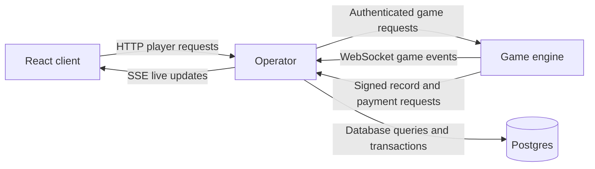
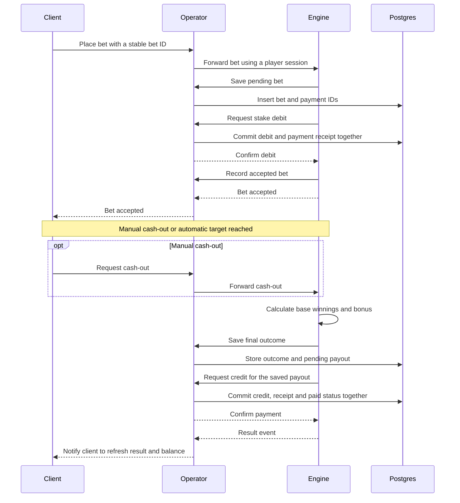
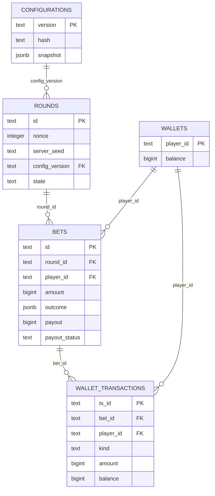

# HighStack - Configurable bonus mechanic

A configurable bonus added to a crash game. Each round draws whether the bonus triggers and, if it does, selects a weighted multiplier. The multiplier applies to the player's winnings, up to a configured cap. Results and payments are saved, and the bonus can be replayed from the original inputs.

The demo uses a **50% bonus chance** to make the mechanic easy to see. A losing bet still pays zero.

## Run with Docker

```sh
docker compose up --build
```

Open **http://localhost:3100**. The demo player starts with $1,000. Place a bet before the round starts, then cash out manually or set an automatic target. Results show the bonus, multiplier, final payout and payment status. Replay is available after the round ends. Balances survive restarts.

## Run without Docker

Requires Node 22+ and a running local PostgreSQL 16+ server. Run these commands from the repository root; your local PostgreSQL user must be able to create databases.

```sh
npm ci
npm run build
createdb highstack
```

Start the operator and client:

```sh
DATABASE_URL=postgres://localhost:5432/highstack npm start
```

In another terminal, start the engine:

```sh
node engine/src/index.js
```

Open **http://localhost:3000**. The operator applies migrations, creates the demo player if needed and serves the built React client.

## Main decisions

- **The engine has no direct database access.** Only the operator connects to Postgres. The engine has no database credentials or database driver, and Docker places Postgres on a separate network. We made this boundary so future game engines, including code written by AI agents, cannot directly read or change casino tables. Game code requests defined operations through the operator instead.
- **All client communication goes through the operator.** It owns player identity, request validation and wallet operations, and forwards game actions to the engine. This keeps server credentials out of the browser and gives us one place to control access.
- **Mechanics are reusable packages.** The bonus accepts a seed, bet and config, and returns an outcome. It knows nothing about the crash game, database or wallet. Another game can supply its own winnings and reuse it. Tests can pass fixed seeds, bets and configs to exercise different outcomes. Further mechanics can follow the same package structure.
- **Wallet changes are atomic.** The payment record, balance update and paid status are saved in one database transaction: either all commit or none do. The wallet is locked while checking funds, so simultaneous requests cannot spend the same balance. A unique payment ID prevents a repeated request from paying twice.
- **Random outcomes can be reproduced.** The seed, round number and config determine the bonus. We save those inputs and the config version so replay uses the original settings even after configuration changes.
- **Interrupted rounds are cancelled rather than resumed from an uncertain state.** When the engine restarts, accepted bets without a saved result are refunded. Already-saved wins retain their payout and are retried. This keeps restart behavior simple and preserves recorded outcomes.

## Architecture and communication



The engine runs the round and calculates the winnings. The operator stores the result and handles payment. The bonus package is imported by the engine for live outcomes and by the operator for replay and demo examples; it is not a separate service.

A successful bet and cash-out follow this sequence:



Saving the outcome and paying it are separate steps. If the process stops between them, the recorded payout remains available to retry. Replay reads the saved seed, round number, bet and config, recalculates the bonus and compares the result. It never makes another payment.

## Data model



The diagram shows the main fields. Each bet has one debit ID and one credit ID. Database constraints prevent negative balances and more than one receipt for the same bet and payment type. Money is stored in cents; multiplication uses integer arithmetic and rounds fractional cents down.

## Repository structure

```text
.
├── client/
│   └── src/                 React betting screen, results and replay
├── engine/
│   ├── src/                 Round loop, game outcomes and wallet requests
│   └── test/                Original engine tests
├── operator/
│   └── src/                 Player API, engine API and payment receiver
├── packages/
│   ├── bonus/
│   │   ├── src/             Bonus calculation and config validation
│   │   └── test/            Mechanic tests
│   └── storage/
│       ├── src/             Database schema, transactions and replay
│       ├── migrations/      Database migrations
│       └── test/            Wallet integration test
├── configs/
│   └── bonus.json           Bonus settings
├── scripts/
│   └── smoke.mjs            Live bet and replay check
├── docker-compose.yml
├── Dockerfile
├── package.json
└── README.md
```

## Change the bonus configuration

Edit [configs/bonus.json](configs/bonus.json). The demo settings are:

```json
{
  "version": "bonus-demo-v2",
  "triggerChance": 0.5,
  "multipliers": [
    { "multiplier": 2, "weight": 60 },
    { "multiplier": 5, "weight": 30 },
    { "multiplier": 10, "weight": 10 }
  ],
  "maxWin": 100000
}
```

| Setting | Meaning |
| --- | --- |
| `version` | Identifies these exact settings. Use a new value whenever the contents change. |
| `triggerChance` | Probability per round: `0.5` is 50%, `0` disables the bonus, `1` always triggers. |
| `multipliers` | Factors and their relative weights after a trigger. Here 2x, 5x and 10x have 60%, 30% and 10% shares. |
| `maxWin` | Maximum total payout in cents. `100000` is $1,000. |

To add another multiplier, add a row such as `{ "multiplier": 20, "weight": 5 }` and change the version. No code changes are needed. Weights need not total 100; each row's share is its weight divided by the total.

The operator validates the file when a new round is created and stores the settings used. Existing rounds and their replays keep the old settings. Different contents under an existing version are rejected. Invalid settings stop new rounds rather than silently using defaults. Example cards load when the operator process starts; restart it to refresh those cards after a config change.

For example, a $10 bet cashed out at 2x gives $20 in base winnings. A 5x bonus makes the total payout $100. If the configured cap is $50, the payout is $50. The original stake is already included in the base win and is not added again. The cap also applies when no bonus triggers.

### Add new configuration fields

The schema deliberately rejects unknown fields. For a new setting, add its validation and behavior in [packages/bonus/src/index.ts](packages/bonus/src/index.ts), add tests, then put it in the JSON with a new version. Keep older settings supported, or retain a version-specific implementation, so saved rounds can still replay.

## Add another mechanic

1. **Create a package**, for example `packages/free-spins`, following `packages/bonus`. Give it its own calculation, validated config and tests. Accept ordinary data such as seed, bet and config; keep game logic, HTTP and database access outside it.
2. **Add its configuration**, for example `configs/free-spins.json`. Extend the config loading in `operator/src/index.ts` and round preparation in `operator/src/engine.ts` so each round receives and saves the required settings.
3. **Connect it to the game.** Add the package dependency and call it from `engine/src/settlement.js`. Update `engine/src/game.js` if the mechanic needs a round-level decision. The engine supplies game-specific inputs; the package stays reusable.
4. **Save and replay the right rule.** Record a mechanic identifier as well as its config version, and dispatch replay to that implementation in `packages/storage/src/index.ts`. Add a migration and update outcome validation if the stored result changes. Keep old implementations available for old rounds.
5. **Expose the result and test it.** Extend `operator/src/examples.ts` and `client/src/main.tsx` for the new result. Add the package to the server build and test commands in `package.json`.

For another game engine, import the same package and supply that game's bet and base winnings. Its integration handles saving and payment. The package does not need to know which game called it.

The current implementation has one mechanic; adding another requires these integration steps. The wallet path can stay the same when the new mechanic still produces one final payout amount.

## Failure handling and known limits

| Situation | What happens |
| --- | --- |
| Duplicate payment or lost response | Retrying the same payment ID returns the saved receipt without moving money again. Reusing the ID with different details is rejected. |
| Two requests spend the same balance | A database row lock makes them check funds in turn. Insufficient funds return 402 without deducting money. |
| Database error during a wallet payment | The balance, receipt and paid status are in one transaction. All are saved together, or the transaction is rolled back. |
| Debit finishes after betting closes | The engine checks the round again before accepting the bet. A debited stake that can no longer be accepted is refunded. |
| Invalid config or changed contents under an old version | Rejected. Correct the config; restart affected services if they stopped. |

Production login, multiple currencies, distributed engine failover and database disaster recovery are not implemented. The operator trusts authenticated game results; replay checks the bonus using saved base winnings, not the original cash-out timing. The official bonus seed/outcome examples mentioned in the assignment were not supplied, so compatibility with those examples has not been checked.

## Code formatting

Prettier keeps code indentation and layout consistent, using two spaces.

```sh
npm run format        # Format the code
npm run format:check  # Check formatting without changing files
```

VS Code and Cursor users can install the recommended Prettier extension to format on save. Generated files, lockfiles and documentation are excluded from formatting.

## Run tests

Unit tests:

```sh
npm test
```

Unit and database tests with Docker:

```sh
docker compose --profile test run --build --rm tests
```

Database tests without Docker, using a separate test database:

```sh
createdb highstack_test
TEST_DATABASE_URL=postgres://localhost:5432/highstack_test npm run test:integration
```

Live smoke test against the running demo; places a $1 demo bet:

```sh
npm run test:smoke
# Without Docker:
DEMO_URL=http://localhost:3000 npm run test:smoke
```

## How we used AI

We used OpenAI Codex to plan the implementation, write code quickly and create a working engine/client prototype for testing. It also helped with tests, code review and documentation.

The first design did not separate responsibilities well enough: it allowed direct client-to-engine communication and direct database access from the engine. It also needed a clearer plan for adding and reusing mechanics. During review, we changed the design so the operator owns database access and all client communication passes through it. We separated the bonus into a package that can be tested independently and reused by different game engines.

Codex helped turn that revised plan into files and functions, which sped up implementation and testing. The architecture needed explicit guidance and review; the first generated version was not treated as the finished design.
